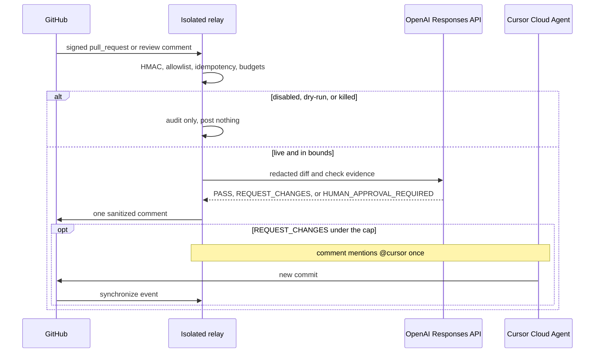

# LVPT agent review relay

Isolated, event-driven reviewer for draft staging pull requests. It is a separate OpenAI API reviewer. It does not wake an existing ChatGPT conversation.

The relay is **off by default**. This repository change does not deploy it, merge it, install a GitHub App, create credentials, or call OpenAI or GitHub.

The command center app does not import this package. Keep it that way. Host it later as its own project if the owner turns it on.

## Flow



Allowed work is only `LuckyMittenGaming/lvpt-event-command-center-2026` pull requests whose base is `feature/unified-command-center-staging` and which carry the `agent-loop` label. `main`, `master`, `production`, and `prod` are rejected in code. Forks are rejected. Authors are limited to `LuckyMittenGaming`, `cursor[bot]`, and `cursor`.

## Why this is not a GitHub Action on the pull request

`pull_request_target` runs trusted workflow code with repository secrets. Checking out the pull request head in that job can execute untrusted code with those secrets. A normal `pull_request` workflow runs the workflow from the pull request, so a pull request could edit the job before it reads a key.

This relay keeps secrets in a separate host. GitHub signs the webhook. The handler verifies `X-Hub-Signature-256` with HMAC-SHA256 and a timing-safe compare. Pull request text is data. It is redacted, length-capped, and fenced. It cannot change the allowlist, the cap, or the instruction to post one bounded comment.

The optional file `examples/workflow_dispatch.yml` only replays local fixtures. It is not installed under `.github/workflows`. It has no secrets and no `pull_request_target` trigger.

## Decisions

| Decision | What happens |
| --- | --- |
| `PASS` | One final comment, no `@cursor`, loop stops |
| `REQUEST_CHANGES` | One comment that mentions `@cursor` once, counted toward the cap of 3 |
| `HUMAN_APPROVAL_REQUIRED` | One final comment, no `@cursor`, loop stops |

A fourth failing head after three corrections stops for a person. A model `PASS` while checks are failing, or a model change request while checks passed, also stops for a person. Model text that contains a secret, email, phone number, or an instruction override is discarded and the loop stops.

If checks are not finished yet, the event is recorded as `evidence_pending`. Nothing is posted and the head stays open so a later allowlisted review comment can review it. The relay does not listen for `check_run` events.

## Flags

| Variable | Safe default | Live requirement |
| --- | --- | --- |
| `AGENT_RELAY_ENABLED` | unset / false | exact `true` |
| `AGENT_RELAY_DRY_RUN` | true | exact `false` |
| `AGENT_RELAY_LIVE` | unset / false | exact `true` |
| `AGENT_RELAY_KILL_SWITCH` | unset / false | must not be `true` |
| `GITHUB_WEBHOOK_SECRET` | empty | 24+ characters, not the fixture secret |
| `AGENT_RELAY_STATE_PATH` | empty | a file path outside `.env` and without `..` |
| GitHub credential | empty | GitHub App, or a one-repo fine-grained PAT |
| `OPENAI_API_KEY` | empty | server-side `sk-` key on the isolated host |

All three of enabled, live, and dry-run-off are required before any OpenAI call or GitHub comment. Anything incomplete fail-closes with `live_misconfigured`. The kill switch stops after the signature check.

Other knobs, all clamped: `AGENT_RELAY_MAX_ITERATIONS` (hard ceiling 3), `AGENT_RELAY_SPEND_CAP_USD` (default `$1`, hard ceiling `$25`, `0` blocks paid calls), `AGENT_RELAY_MAX_OUTPUT_TOKENS` (default 800), `AGENT_RELAY_TIMEOUT_MS` (default 20000), `AGENT_RELAY_MODEL` (default `gpt-4.1-mini`). The OpenAI URL is fixed to `https://api.openai.com/v1/responses`. An environment override cannot point the key at another host.

## Offline checks

```bash
npm run test:agent-relay
node tools/agent-review-relay/cli/replay.mjs tools/agent-review-relay/fixtures/cursor-loop.json
node tools/agent-review-relay/cli/replay.mjs tools/agent-review-relay/fixtures/prompt-injection.json
```

The replay command forces simulation mode. It ignores ambient API keys and webhook secrets. The fixture secret `fixture-webhook-secret-not-real` is public and is refused for live mode.

The suite covers signature checks, wrong repo / base / label / author / fork, duplicate deliveries, duplicate heads, a failed reviewer, a failed comment post, the iteration cap, stop on pass, spend cap, kill switch, disabled default, prompt injection, and a mocked live post. No test calls OpenAI or GitHub.

## One-time owner setup

Do these steps only if you decide to run the relay. They are not done in this change.

1. Create a **new** Vercel project whose root is `tools/agent-review-relay`, or another host that runs only this package. Do not add `examples/separate-project-function.mjs` to the command center `app/api` tree, and do not put these variables on the production command center project.
2. In OpenAI, create an API key on a **separate** project from any ChatGPT subscription. Set a monthly budget before the first live call. Five dollars is a reasonable first ceiling. API usage is billed separately from ChatGPT Plus or Pro. Put the key only in the isolated host as `OPENAI_API_KEY`.
3. Create a GitHub App installed only on `LuckyMittenGaming/lvpt-event-command-center-2026`. Permissions: Pull requests read/write, Contents read, Checks read, Metadata read. No administration, workflows, secrets, or emails. Subscribe to `pull_request` and `pull_request_review_comment`. Store the app id, installation id, and private key as `GITHUB_APP_ID`, `GITHUB_APP_INSTALLATION_ID`, and `GITHUB_APP_PRIVATE_KEY`. The relay mints a short-lived installation token itself.
4. A fine-grained PAT restricted to this one repository, with the same read/write pull-request scope and read scopes for contents and checks, also works as `GITHUB_TOKEN`. Prefer the app. Do not use a classic token with repo-wide admin scope.
5. Generate a webhook secret of at least 24 random characters. Store it as `GITHUB_WEBHOOK_SECRET` on the isolated host and on the GitHub App. Do not commit it.
6. Choose a state file path on that host (`AGENT_RELAY_STATE_PATH`). The file is mode `0600`. It is single-instance. Deleting it resets iteration counts.
7. Leave the relay disabled and run the replay commands above.
8. To watch real events without posting, set only `AGENT_RELAY_ENABLED=true` and keep dry-run on. Audit records stay on the state file.
9. Live posting requires `AGENT_RELAY_ENABLED=true`, `AGENT_RELAY_LIVE=true`, and `AGENT_RELAY_DRY_RUN=false`, plus the secret, state path, GitHub credential, and OpenAI key. Apply the `agent-loop` label only to draft pull requests against `feature/unified-command-center-staging`.
10. Set `AGENT_RELAY_KILL_SWITCH=true` to stop. The next valid event records `killed` and posts nothing.

Price inputs `AGENT_RELAY_INPUT_USD_PER_MILLION` (default `0.4`) and `AGENT_RELAY_OUTPUT_USD_PER_MILLION` (default `1.6`) are estimates for the default model, not an invoice. Confirm current OpenAI prices before relying on the cap. The OpenAI dashboard budget is the real spend control. This process cap is a second, smaller brake.

## Continuing in ChatGPT

Each comment tells a person to open the pull request URL in ChatGPT. The URL is built as `https://github.com/LuckyMittenGaming/lvpt-event-command-center-2026/pull/<number>`. The relay never claims it resumed a chat. Paste that URL into ChatGPT when a person should take the next step.

The label must already be present when the pull request is opened or synchronized. Adding it later does not by itself start a review. The next push, or a review comment from an allowlisted author, does.

## Security checklist

- Signature required. Missing secret, `sha1` signatures, and bad HMACs return 401 and are not written into the audit store.
- Repository, base branch, label, author, and same-repo head are enforced. Production branch names are hard-denied.
- Delivery id plus pull request and head SHA idempotency. One comment per head.
- Cap of 3 autonomous `@cursor` corrections, a time budget, a stale-event window, and a spend estimate.
- Pull request title, body, and comments are untrusted. Secrets and contact details are redacted before a live prompt is built.
- Reviewer output is schema-checked. Leaks and instruction echoes become a human stop. The posted comment is rendered from that cleaned result, and `@cursor` is added by the template only.
- Paths under `.env`, `.github`, `apps-script`, `sql`, `vercel.json`, this relay, and the Gmail, SMS, and sync routes stop for a person.
- Audit fields are event id, repo, pull request, SHA, decision, transition, iteration, token count, and cost estimate. No prompt, raw body, login, email, or phone.
- Live mode cannot target a non-OpenAI URL.
- Tests and the replay CLI use a fetch implementation that refuses the network unless a test supplies a mock.

## Limitations

- File state does not coordinate multiple server instances. Turn live mode on only for a single instance until a shared store is added. Two instances can double-post.
- Deleting or replacing the state file resets the correction count.
- The spend figure is an estimate. A model price change or a missing usage field (charged at the configured maximum) will not match the OpenAI invoice.
- `gpt-4.1-mini` is the default. Some newer models reject `temperature: 0`. If a live call fails for that reason, the loop stops with `api_failure_stopped` instead of posting a task. Check the model’s request rules before enabling it.
- Open and synchronize events often arrive before checks finish. Those return `evidence_pending` and wait for a later allowlisted review comment. There is no `check_run` subscription in this version.
- Check evidence uses check names and a truncated, redacted diff. It does not send full CI logs.
- A pull request with 100 or more files stops for a person because the file list may be truncated.
- Best-effort redaction is not a substitute for keeping secrets and customer contact details out of pull requests.
- A review comment that quotes the relay marker is ignored. That can only suppress a review, not widen one.
- This package does not merge, deploy, send email, send SMS, or pair any messaging account.
