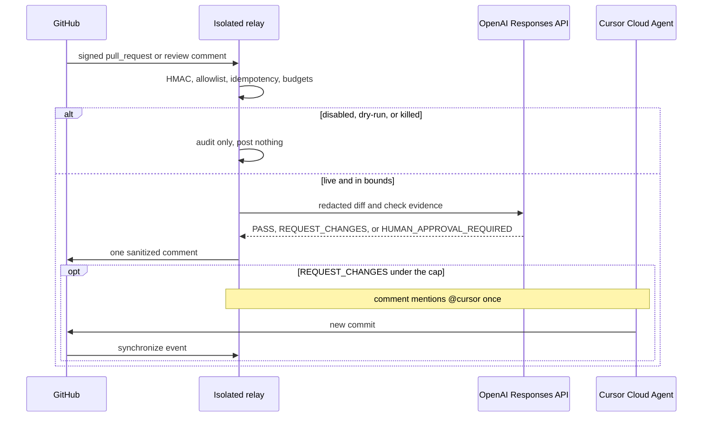

# LVPT agent review relay

Isolated, event-driven reviewer for draft staging pull requests. It is a separate OpenAI API reviewer. It does not wake an existing ChatGPT conversation.

The relay is **off by default**. This repository change does not deploy it, merge it, install a GitHub App, create credentials, or call OpenAI or GitHub.

The command center app does not import this package. Keep it that way. Host it later as its own project if the owner turns it on.

## Flow



Allowed work is only `LuckyMittenGaming/lvpt-event-command-center-2026` pull requests whose base is `feature/unified-command-center-staging` and which carry the `agent-loop` label. `main`, `master`, `production`, and `prod` are rejected in code. Forks are rejected. Authors are limited to `LuckyMittenGaming`, `cursor[bot]`, and `cursor`.

## Why this is not a GitHub Action on the pull request

`pull_request_target` runs trusted workflow code with repository secrets. Checking out the pull request head in that job can execute untrusted code with those secrets. A normal `pull_request` workflow runs the workflow from the pull request, so a pull request could edit the job before it reads a key.

This relay keeps secrets in a separate host. GitHub signs the webhook. The handler verifies `X-Hub-Signature-256` with HMAC-SHA256 and a timing-safe compare. Pull request text is data. It is redacted, length-capped, and fenced. It cannot change the allowlist, the cap, or the instruction to post one bounded comment.

The optional file `examples/workflow_dispatch.yml` only replays local fixtures. It is not installed under `.github/workflows`. It has no secrets and no `pull_request_target` trigger.

## Decisions

| Decision | What happens |
| --- | --- |
| `PASS` | One final comment, no `@cursor`, loop stops |
| `REQUEST_CHANGES` | One comment that mentions `@cursor` once, counted toward the cap of 3 |
| `HUMAN_APPROVAL_REQUIRED` | One final comment, no `@cursor`, loop stops |

A fourth failing head after three corrections stops for a person. A model `PASS` while checks are failing stops for a person. A model change request after green checks is posted only when it cites a concrete finding on a file in the diff. A request with no such finding stops for a person. After three corrections, a green head is still reviewed; it is not marked passed just because CI is green. Model text that contains a secret, email, phone number, or an instruction override is discarded and the loop stops.

Accepted events are `pull_request` `opened` and `synchronize`, `pull_request_review_comment` `created`, `issue_comment` `created` on a pull request, `check_run` `completed`, and commit `status`. The pull request must be a draft. If checks are not finished, the event is `evidence_pending` and the head stays open. A later `check_run` or `status` event reviews that head without a person commenting. Comments that contain the relay marker are ignored, so the relay does not reply to itself. Live evidence reads both check runs and commit statuses. A successful Vercel status confirms that deployment build. It does not by itself prove a dedicated unit-test suite ran, so independent testing is still required before treating this relay as production-grade. No checks at all cannot be a pass. Before a live review and again before a comment, the relay re-reads the pull request and refuses to comment if the head SHA changed.

## Flags

| Variable | Safe default | Live requirement |
| --- | --- | --- |
| `AGENT_RELAY_ENABLED` | unset / false | exact `true` |
| `AGENT_RELAY_DRY_RUN` | true | exact `false` |
| `AGENT_RELAY_LIVE` | unset / false | exact `true` |
| `AGENT_RELAY_KILL_SWITCH` | unset / false | must not be `true` |
| `GITHUB_WEBHOOK_SECRET` | empty | 24+ characters, not the fixture secret |
| `UPSTASH_REDIS_REST_URL` | empty | `https://*.upstash.io` only |
| `UPSTASH_REDIS_REST_TOKEN` | empty | 20+ characters, server-side |
| GitHub credential | empty | GitHub App, or a one-repo fine-grained PAT |
| `OPENAI_API_KEY` | empty | server-side `sk-` key on the isolated host |

All three of enabled, live, and dry-run-off are required before any OpenAI call or GitHub comment. Anything incomplete fail-closes with `live_misconfigured`. The kill switch stops after the signature check.

Other knobs, all clamped: `AGENT_RELAY_MAX_ITERATIONS` (hard ceiling 3), `AGENT_RELAY_SPEND_CAP_USD` (default `$1`, hard ceiling `$25`, `0` blocks paid calls), `AGENT_RELAY_MAX_OUTPUT_TOKENS` (default 800), `AGENT_RELAY_TIMEOUT_MS` (default 20000), `AGENT_RELAY_MODEL` (default `gpt-4.1-mini`). The OpenAI URL is fixed to `https://api.openai.com/v1/responses`. An environment override cannot point the key at another host.

## Offline checks

```bash
npm run test:agent-relay
node tools/agent-review-relay/cli/replay.mjs tools/agent-review-relay/fixtures/cursor-loop.json
node tools/agent-review-relay/cli/replay.mjs tools/agent-review-relay/fixtures/prompt-injection.json
```

The replay command forces simulation mode. It ignores ambient API keys and webhook secrets. The fixture secret `fixture-webhook-secret-not-real` is public and is refused for live mode.

The suite covers signature checks, wrong repo / base / label / author / fork / non-draft, duplicate deliveries across two instances, duplicate heads, a failed reviewer, a failed comment post, the iteration cap, review-on-green, stop on pass, spend cap, kill switch, disabled default, prompt injection, check completion, Vercel status evidence, a moved head, and live wiring through mocked HTTP. Dry-run and replay do not call the network. Live mode is the only path that uses the host `fetch`.

## One-time owner setup

Do these steps only if you decide to run the relay. They are not done in this change.

1. Create a **new** Vercel project and set its root directory to `tools/agent-review-relay`. The route is `api/webhook.js` (`vercel.json` turns the JSON body parser off so the HMAC sees the raw body). Do not attach this route to the command center project, and do not put these variables on production. A preview that Vercel builds from the repository root is the dashboard, not this relay.
2. In OpenAI, create an API key on a **separate** project from any ChatGPT subscription. Set a monthly budget before the first live call. Five dollars is a reasonable first ceiling. API usage is billed separately from ChatGPT Plus or Pro. Put the key only in the isolated host as `OPENAI_API_KEY`.
3. Create a GitHub App installed only on `LuckyMittenGaming/lvpt-event-command-center-2026`. Permissions: Pull requests read/write, Contents read, Checks read, Metadata read. No administration, workflows, secrets, or emails. Subscribe to `pull_request`, `pull_request_review_comment`, `issue_comment`, `check_run`, and `status`. Store the app id, installation id, and private key as `GITHUB_APP_ID`, `GITHUB_APP_INSTALLATION_ID`, and `GITHUB_APP_PRIVATE_KEY`. The relay mints a short-lived installation token itself. Point the webhook at `https://<isolated-host>/api/webhook`.
4. A fine-grained PAT restricted to this one repository, with the same read/write pull-request scope and read scopes for contents and checks, also works as `GITHUB_TOKEN`. Prefer the app. Do not use a classic token with repo-wide admin scope.
5. Generate a webhook secret of at least 24 random characters. Store it as `GITHUB_WEBHOOK_SECRET` on the isolated host and on the GitHub App. Do not commit it.
6. Create a new Upstash Redis database that is not shared with customer data. Put its REST URL and token in `UPSTASH_REDIS_REST_URL` and `UPSTASH_REDIS_REST_TOKEN`. The URL is accepted only when it is `https://*.upstash.io`. Check current Upstash pricing before choosing a plan; this relay sends a handful of commands per event, so a free database is usually enough. This change does not create that database. A filesystem path cannot satisfy live mode.
7. Leave the relay disabled and run the replay commands above.
8. To watch real events without posting, set only `AGENT_RELAY_ENABLED=true` and keep dry-run on. Dry-run keeps its idempotency in memory for that process and does not call OpenAI or GitHub.
9. Live posting requires `AGENT_RELAY_ENABLED=true`, `AGENT_RELAY_LIVE=true`, and `AGENT_RELAY_DRY_RUN=false`, plus the webhook secret, Upstash credentials, GitHub credential, and OpenAI key. Apply the `agent-loop` label only to draft pull requests against `feature/unified-command-center-staging`.
10. Set `AGENT_RELAY_KILL_SWITCH=true` to stop. The next valid event records `killed` and posts nothing.

Price inputs `AGENT_RELAY_INPUT_USD_PER_MILLION` (default `0.4`) and `AGENT_RELAY_OUTPUT_USD_PER_MILLION` (default `1.6`) are estimates for the default model, not an invoice. Before each review the relay reserves an estimate that includes the system prompt, the JSON schema, the request envelope, the full user-text budget, and the full output budget. The audit stores the token counts and the cost computed from those counts. If the reported tokens cost more than the reservation, the difference is added to the in-process total so the next review stops when the cap is exhausted. Confirm current OpenAI prices before relying on the cap. The OpenAI dashboard budget is the real spend control. This process cap is a second, smaller brake.

## Cursor Cloud Agents handoff

This path is off unless `AGENT_RELAY_CURSOR_API=true`. A mention of `@cursor` in a GitHub comment did not reliably start a cloud agent, so the opt-in path calls the Cloud Agents API instead.

The current public-beta contract, checked against the Cursor docs, is `POST https://api.cursor.com/v1/agents` with Basic auth (`apiKey:`), `repos[0].url`, `repos[0].prUrl` set to the existing pull request, `workOnCurrentBranch: true`, and `autoCreatePR: false`. The host is fixed. A later event may call `GET /v1/agents/{id}/runs/{runId}` once. The relay does not stream or poll in the background.

The handoff runs only after the same repository, base, draft, label, author, path, and head checks, and only for a sanitized `REQUEST_CHANGES` under the configured cap. The relay claims that dispatch in the shared store before the HTTP call. A timeout, network error, or `5xx` is stored as ambiguous and is not retried. Another correction waits until the recorded run is `FINISHED`, `ERROR`, `CANCELLED`, or `EXPIRED`. After the cap, one later head can still be reviewed, and that review cannot start another run. `PASS` still requires passing checks and no material finding.

`AGENT_RELAY_CURSOR_SPEND_AUTHORIZED=true` is a separate switch. It does not set or enforce a dollar amount. Cursor's API does not give this relay a hard spend cap. Before turning the switch on, set an account or team spend limit in the Cursor dashboard. `CURSOR_API_KEY` is a user or service-account key from Cursor Dashboard → API Keys. If either value is missing, the relay does not launch and does not fall back to a `@cursor` mention.

When the flag is off, the GitHub comment can still mention `@cursor` once. The comment states the configured cap (`AGENT_RELAY_MAX_ITERATIONS`, ceiling 3), not a hidden constant.

The v1 Cloud Agents API documents completion webhooks as not available yet. The legacy v0 webhooks are not used. Vercel Cron is also not used: cron entries in `vercel.json` run only on production deployments, and this preview host must not depend on that. Reconciliation is `POST /api/reconcile` on the isolated preview host. The route runs only when `VERCEL_ENV=preview`. A production value is refused. Set `AGENT_RELAY_RECONCILE_URL` to the exact preview URL, for example `https://<preview-host>/api/reconcile`.

The endpoint accepts a QStash `Upstash-Signature` or, for a private scheduler, `x-relay-reconcile-signature` as HMAC-SHA256 of the raw body with `AGENT_RELAY_RECONCILE_SECRET` (at least 24 characters). The QStash check follows the same rules as the Upstash Receiver: the JWT `alg` must be `HS256`, `sub` must equal `AGENT_RELAY_RECONCILE_URL`, the body hash must match, and `nbf`/`exp` must be current. The body hash accepts the padded form QStash puts in the JWT and the unpadded form, after removing trailing `=` from both. A rejected signature log records only booleans and a reason category. A signature is accepted once. The request body cannot choose a SHA or a pull request URL.

Each call checks at most 10 pending runs and rotates through the index, which holds at most 50 runs. Adding a run is the same Redis commit as the correction floor, so a full index does not reserve a correction. A launch claim has a grace window of at least 90 seconds. The scheduler does not mark that claim ambiguous while the launch is still inside the window, and a confirmed agent id is stored even if the claim was already closed. A finished run is reviewed by the same path the webhook uses. That path reserves the OpenAI estimate, checks the changed files, and reads the pull request again before it publishes. `ERROR`, `CANCELLED`, and `EXPIRED` stop with a comment and are not reviewed. A comment that fails stays pending and is retried. A store error does not delete the pending run.

A Cursor launch also requires this same preview scheduler to be ready. The live pilot values are `VERCEL_ENV=preview`, `AGENT_RELAY_MAX_ITERATIONS=1`, and `AGENT_RELAY_SPEND_CAP_USD=0.25`, plus the Cursor key, `AGENT_RELAY_CURSOR_SPEND_AUTHORIZED=true`, and `AGENT_RELAY_CURSOR_API=true`. If any of those is missing, the relay does not call Cursor. `POST /api/reconcile` does nothing unless the runtime is live and those same gates pass. It does not fall through to the in-memory store.

Create the schedule in the QStash console, aimed at that exact preview URL, about once a minute, with body `{}`. Put `QSTASH_CURRENT_SIGNING_KEY` and `QSTASH_NEXT_SIGNING_KEY` only on that preview project. Preview deployments are behind Vercel Deployment Protection. In the preview project, open Settings → Deployment Protection → Protection Bypass for Automation, and add that value only as the QStash request header `x-vercel-protection-bypass`. Do not commit the value, do not paste it into a pull request, and do not put it in the command center project. Do not add a cron to the command center project. The pilot cap stays one correction and the OpenAI estimate stays `$0.25`. A failed status comment is retried with the same decision. A `PASS` retry is posted only if the current pull request head and allowlists still match.

A run that finishes with a new head is reviewed once and is not dispatched again. A run that finishes on the same head, or that ends as `ERROR`, `CANCELLED`, or `EXPIRED`, is stopped. Missing evidence and unknown status are retried a few times, then stopped. A run older than `AGENT_RELAY_RECONCILE_TIMEOUT_MS` (default 20 minutes, maximum 2 hours) is stopped. The correction count is reserved before the Cursor request, and the agent and run ids are stored before the GitHub comment is attempted.

The current Cloud Agents API docs say to create a user API key at Cursor Dashboard → API Keys, or to use a service-account key. Both Basic (`apiKey:`) and Bearer authentication are accepted. A personal dashboard key is not rejected here because of its prefix. The signed preview scheduler checks that key with read-only `GET /v1/me` and `GET /v1/agents?limit=1` before any launch. A successful `/v1/me` by itself does not start an agent. A `403` is treated as unsupported, a `429` as rate limited, and any error fails closed. A successful check is remembered for 10 minutes. Requests use `redirect: "error"`. The log records only the HTTP status and a category.

## Continuing in ChatGPT

Each comment tells a person to open the pull request URL in ChatGPT. The URL is built as `https://github.com/LuckyMittenGaming/lvpt-event-command-center-2026/pull/<number>`. The relay never claims it resumed a chat. Paste that URL into ChatGPT when a person should take the next step.

The label must already be present when the pull request is opened or synchronized. Adding it later does not by itself start a review. The next push, or a review comment from an allowlisted author, does.

## Security checklist

- Signature required. Missing secret, `sha1` signatures, and bad HMACs return 401 and are not written into the audit store.
- Repository, base branch, label, author, and same-repo head are enforced. Production branch names are hard-denied.
- Delivery id plus pull request and head SHA idempotency. One comment per head.
- Cap of 3 autonomous `@cursor` corrections, a time budget, a stale-event window, and a spend estimate.
- Pull request title, body, and comments are untrusted. Secrets and contact details are redacted before a live prompt is built.
- Reviewer output is schema-checked. Leaks and instruction echoes become a human stop. The posted comment is rendered from that cleaned result, and `@cursor` is added by the template only.
- Paths under `.env`, `.github`, `apps-script`, `sql`, `vercel.json`, this relay, and the Gmail, SMS, and sync routes stop for a person.
- Audit fields are event id, repo, pull request, SHA, decision, transition, iteration, token count, and cost estimate. No prompt, raw body, login, email, or phone.
- Live mode uses the host `fetch` only after every live gate passes. Dry-run, replay, and tests refuse the network unless a test installs a mock. The OpenAI URL cannot be redirected, and the Redis URL cannot leave Upstash.
- The correction count is stored beside a floor that the relay never lowers. A missing pull-request record with a surviving floor fail-closes instead of starting again at zero. Flushing the whole database is an owner action and does reset the floor.

## Limitations

- The spend figure is an estimate. A model price change or a missing usage field (charged at the configured maximum) will not match the OpenAI invoice. The OpenAI dashboard budget remains the real control. Two live calls that pass the cap check in the same moment can both complete; the next event then stops.
- `gpt-4.1-mini` is the default. Some newer models reject `temperature: 0`. If a live call fails for that reason, the loop stops with `api_failure_stopped` instead of posting a task. Check the model’s request rules before enabling it.
- If the store is down, the delivery is refused and is not retried by this process. A later GitHub event can try again. A failed save does not schedule another model call for that same delivery.
- Check evidence uses check names, status contexts, and a truncated, redacted diff. It does not send full CI logs. A green Vercel status confirms the deployment build that status reported. It does not prove a dedicated unit-test suite ran. This relay is not production-grade until that testing is done separately.
- This relay does not wake a ChatGPT conversation. A person continues by opening the pull request URL.
- A pull request with 100 or more files stops for a person because the file list may be truncated.
- Best-effort redaction is not a substitute for keeping secrets and customer contact details out of pull requests.
- A review comment that quotes the relay marker is ignored. That can only suppress a review, not widen one.
- This package does not merge, deploy, send email, send SMS, or pair any messaging account.
